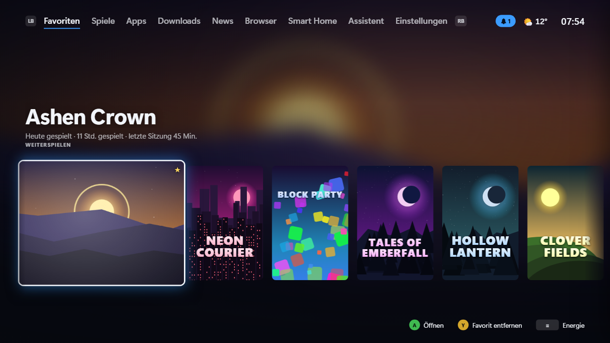
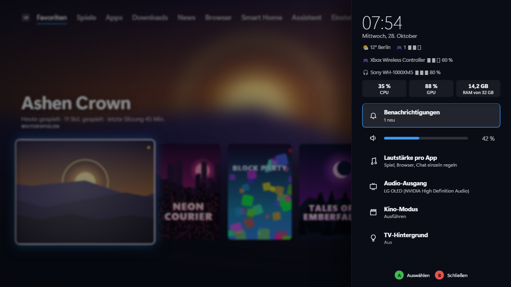
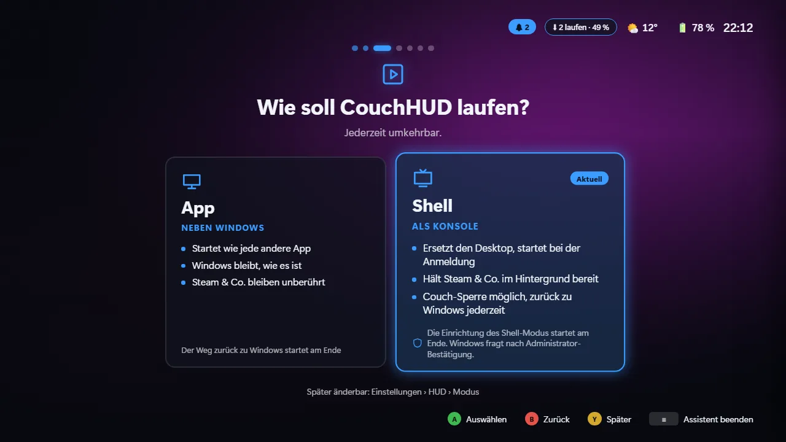
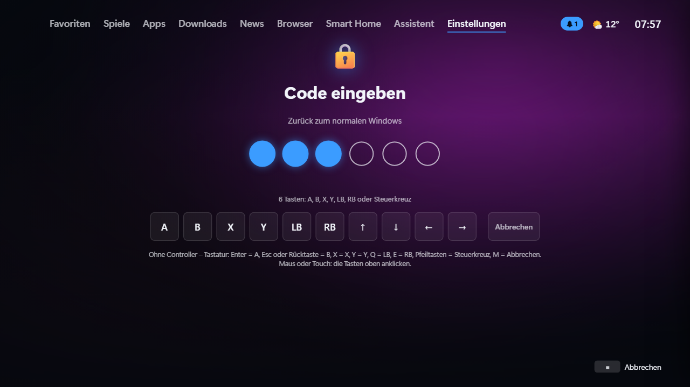
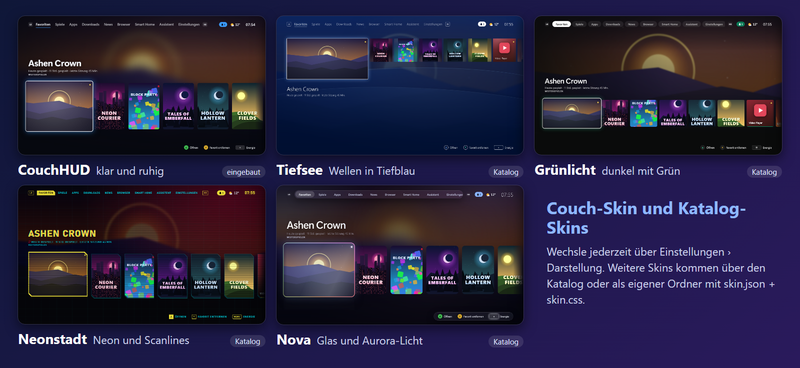
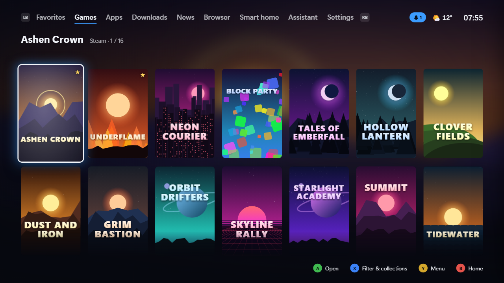
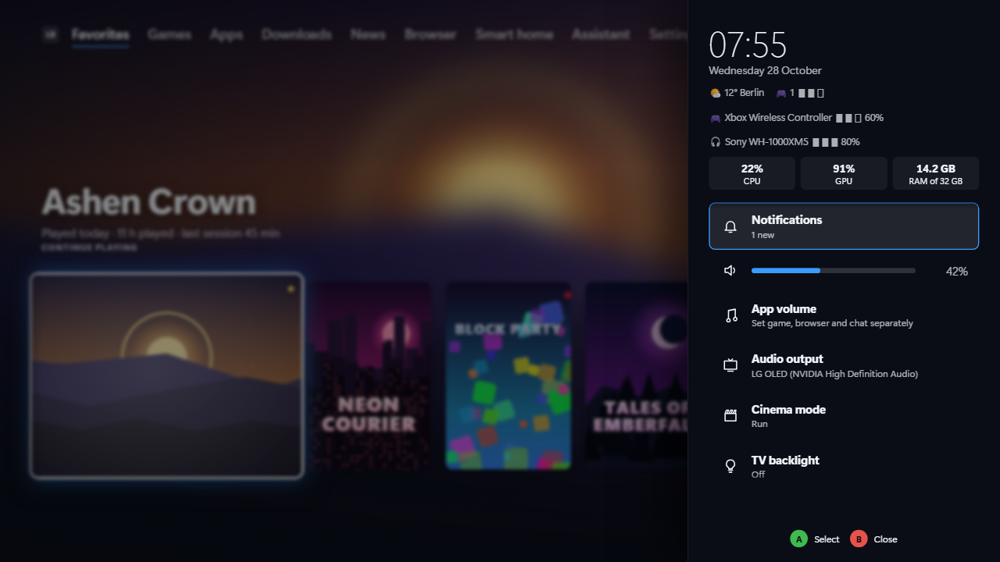
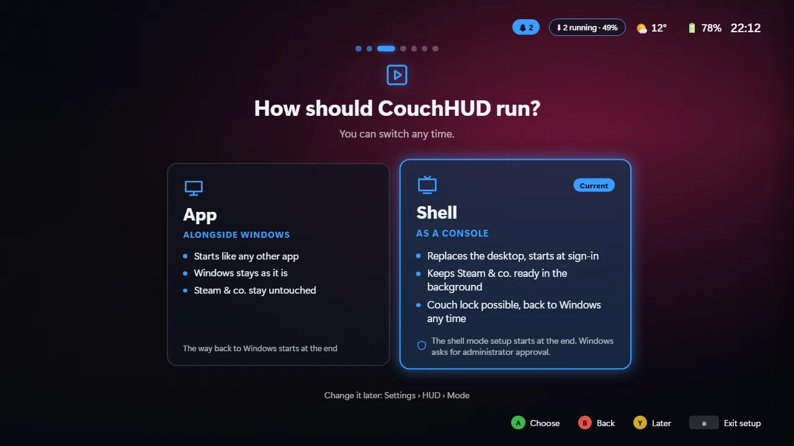
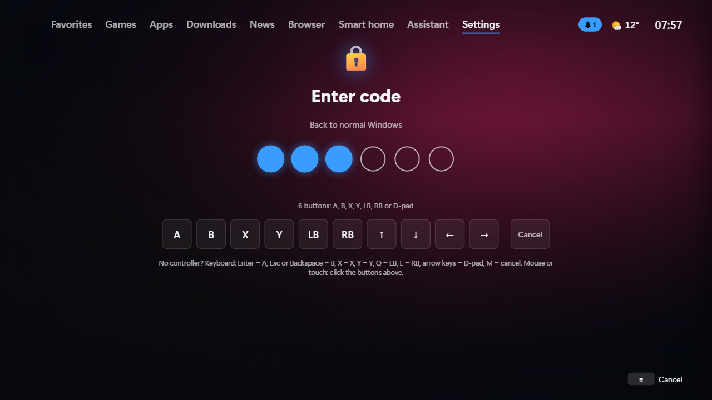
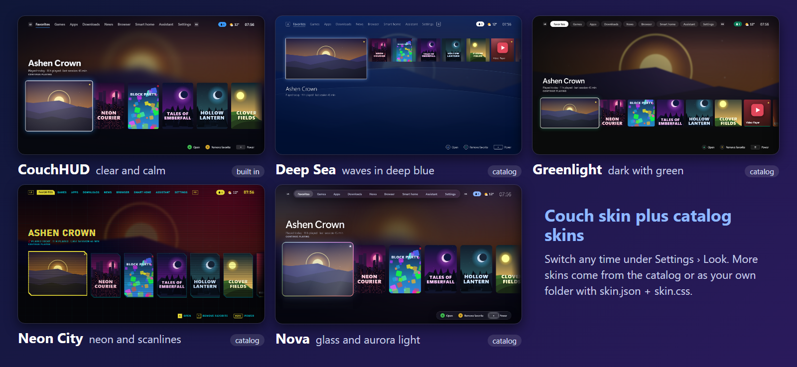

**Deutsch** | [English](#english)

<p align="center"></p>

<p align="center">
  <b>Die Konsole für deinen Windows-PC am Fernseher.</b><br>
  <i>Your Windows PC on the TV, run like a console.</i>
</p>

<p align="center">
  <a href="https://github.com/kewe87/CouchHUD/releases/latest"></a>
  <a href="https://github.com/kewe87/CouchHUD/actions/workflows/build.yml"></a>
  <a href="LICENSE"></a>
</p>

<p align="center"></p>

<sub>Die Spiele in den Screenshots sind ausgedacht, ihre Cover von der Vorschau selbst gezeichnet. / The games in the screenshots are made up, their covers drawn by the preview.</sub>

---

<a id="deutsch"></a>

## Deutsch

> Die erste öffentliche Version war 0.4.1, die aktuelle steht unter [Releases](https://github.com/kewe87/CouchHUD/releases/latest). Windows 10/11 x64, ein XInput-Controller.
> Rückmeldungen von echter Wohnzimmer-Hardware sind sehr willkommen.

### Was ist CouchHUD?

Eine Oberfläche nur für den Controller. Einschalten, Controller nehmen, spielen.

- **Eine Bibliothek:** Steam, Epic, GOG, Ubisoft Connect, Xbox/Game Pass und eigene Einträge, mit Artwork auch für Nicht-Steam-Spiele
- **Guide-Taste über jedem Spiel:** Lautstärke pro App, Audio-Ausgang, Bluetooth, Benachrichtigungen, Energie; halten bringt dich zurück
- **Statt des Desktops:** CouchHUD startet bei der Anmeldung, Steam & Co. halten sich leise im Hintergrund bereit
- **Fürs Sofa gebaut:** Browser als Tab, Bildschirmtastatur, Handy als Fernbedienung, WLAN, Anzeige, Updates
- **Couch-Skin** mit eigenen Sounds und Mauszeiger eingebaut, dazu weitere Skins und Plugins aus dem signierten Katalog
- **Couch-Sperre und Jugendschutz**, Admin-Arbeit im Hintergrunddienst: keine UAC-Abfragen im Alltag

Kostenlos, offen (GPL-3.0), ohne Konto, ohne Telemetrie.

<p align="center">
  
  
</p>

### App oder Shell

Der Einrichtungsassistent fragt beim ersten Start: App oder Shell, Skin, Ton, Spiele-Clients, Couch-Sperre.
Alles bleibt später in den Einstellungen änderbar.

| | **App** (Standard) | **Shell** |
|---|---|---|
| Start | wie jede andere App | statt des Desktops, bei der Anmeldung |
| Windows | bleibt, wie es ist | Shell-Ersatz, Autologin, pausierte Dienste |
| Steam & Co. | unberührt | im Hintergrund bereit |
| Couch-Sperre | – | Controller-Code |
| Rückweg | – | *Einstellungen › HUD › Modus › In den App-Modus wechseln* |

<p align="center"></p>

### Installieren

1. Unter [Releases](https://github.com/kewe87/CouchHUD/releases/latest) das neueste `CouchHud-Setup-<Version>.exe` herunterladen und ausführen.
2. Controller nehmen, der Assistent führt durch den Rest.

**Was das Setup installiert:**
- CouchHUD nach `C:\Program Files\CouchHud` (fest, kein anderer Ordner)
- den Windows-Dienst **CouchHUD Service** (`CouchHud.Service`) für alle Admin-Aufgaben
- bei Bedarf die WebView2-Runtime, Startmenü-Eintrag, optional Desktop-Symbol und Autostart

**Voraussetzungen:** Windows 10 (ab 1809) oder 11, x64, WebView2-Runtime (bringt das Setup mit), XInput-Controller
(Xbox-Pad, PlayStation-Pads über Steam Input oder DS4Windows).

Das Setup hat noch keine Authenticode-Signatur, SmartScreen warnt deshalb beim ersten Start. Echtheit prüfst du so:

<details>
<summary><b>Download prüfen</b> (Prüfsumme, Signatur, Herkunft)</summary>

Aus demselben Release `CouchHud-Setup-<Version>.exe`, `.sha256` und `.sha256.sig` in einen Ordner laden, dort in PowerShell 7:

```powershell
$f = 'CouchHud-Setup-<Version>.exe'   # <Version> durch die geladene ersetzen, z. B. aus dem Dateinamen

# 1. Prüfsumme: True
(Get-FileHash $f -Algorithm SHA256).Hash -eq (Get-Content "$f.sha256").Split(' ')[0]

# 2. Signatur der Prüfsummen-Datei (ECDSA P-256): True
$pem = @'
-----BEGIN PUBLIC KEY-----
MFkwEwYHKoZIzj0CAQYIKoZIzj0DAQcDQgAEKAXgwgjwj5Rjl37hmf04Cj+/vP8S
JIKCCqRKrBy7MlNVIntuH2DjOkZMiobyQwlIZ3A20ypGgx77rtHg8vs88Q==
-----END PUBLIC KEY-----
'@
$key = [Security.Cryptography.ECDsa]::Create(); $key.ImportFromPem($pem)
$data = [Text.Encoding]::ASCII.GetBytes("couchhud-release-v1`n") + [IO.File]::ReadAllBytes("$PWD\$f.sha256")
$key.VerifyData([byte[]]$data, [Convert]::FromBase64String((Get-Content "$f.sha256.sig" -Raw).Trim()), 'SHA256')

# 3. Herkunft: von der CI dieses Repos gebaut (GitHub CLI)
gh attestation verify $f --repo kewe87/CouchHUD --signer-workflow kewe87/CouchHUD/.github/workflows/build.yml
```

- Derselbe Schlüssel prüft auch Self-Update und Katalog. Fingerabdruck: [SECURITY.md](SECURITY.md).
- Den Herkunftsnachweis (Build Provenance) gibt es nur für Releases, die gebaut wurden, während das Repo öffentlich ist.

</details>

**Notfall:** Beim Start **Strg + Umschalt** oder **LB + RB + View** etwa 1,5 Sekunden halten. Windows sperrt, nach der
Anmeldung mit dem Windows-Kennwort kommt der normale Desktop. Mehr im [Handbuch](docs/GUIDE.md#notausgang).

### Steuerung

| Controller | Tastatur | Aktion |
|---|---|---|
| D-Pad / linker Stick | Pfeiltasten | Navigieren |
| A | Enter | Öffnen / Auswählen |
| B | Esc | Zurück |
| X | X | Kontextaktion (suchen, sortieren, aktualisieren) |
| Y | Y | Favorit, Menü zur Kachel |
| LB / RB | Q / E | Tab wechseln |
| Start (≡) | M | Energie-Menü |
| Guide | Pos1 | Guide-Menü; **halten** bringt aus jedem Spiel zurück |
| Back + Start | – | statt der Guide-Taste |

Alle Tasten: [Handbuch › Steuerung](docs/GUIDE.md#steuerung).

### Couch-Sperre und Jugendschutz

<p align="center"></p>

- **Couch-Sperre:** Raus aus CouchHUD nur mit Controller-Code (6–8 Tasten) oder Windows-Anmeldung. Gesperrt starten nur Spiele.
- **Jugendschutz:** Spielzeit pro Tag, Zeitfenster, Limits pro Spiel, Altersgrenze; mehr Zeit nur mit Eltern-Code.
- Stürzt CouchHUD ab oder wird beendet, sperrt sich Windows.

### Sicherheit

- **Admin nur im Dienst:** `CouchHud.Service` erledigt Admin-Aufgaben über eine feste Befehlsliste. CouchHud.exe läuft nie mit Admin-Rechten.
- **Codes prüft der Dienst**, mit wachsender Wartezeit nach Fehlversuchen. Eltern- und Admin-Freigaben laufen über den Windows-Anmeldedialog auf dem sicheren Desktop.
- **Fail-closed:** Fehlt der Dienst, bleibt die Sperre zu und Windows wird gesperrt. *Dienst reparieren* richtet ihn neu ein (eine UAC-Abfrage, nur Windows-Programme).
- **Nur Signiertes:** Self-Update, Katalog und Plugin-Pakete prüfen eine ECDSA-Signatur.
- **Ehrliche Grenzen:** Schutz gegen Kinder und Gäste am Controller, nicht gegen Admins, fremden Code im selben Konto, Startmedien oder ausgebaute Laufwerke. Gutes Windows-Kennwort und BitLocker bzw. Geräteverschlüsselung empfohlen.

Details, Grenzen und Lücken melden: [SECURITY.md](SECURITY.md) · [Haftungsausschluss](docs/DISCLAIMER.md) · [Datenschutz](docs/PRIVACY.md)

### Plugins, Skins und Katalog

<p align="center"></p>

- **Skins** sind CSS plus optionale Glyphen, Sounds und Mauszeiger: [docs/SKINS.md](docs/SKINS.md)
- **Plugins** (C#) bringen Spiele-Quellen, Seiten, Einstellungen und Guide-Menü-Einträge: [docs/PLUGINS.md](docs/PLUGINS.md)
- **Katalog** [`kewe87/CouchHUD-Catalog`](https://github.com/kewe87/CouchHUD-Catalog): Installieren mit A, signierter Index, Pflicht-Prüfsumme
- Mitgeliefert: das Plugin **Wand** (Cheats und Mods), zugleich Beispiel für eigene Plugins

### Home Assistant, CaseHUD und VPN

Smart Home (Home Assistant), CaseHUD (die LCDs in Lüftern und Pumpen) und das VPN (NordVPN) sind keine Teile von CouchHUD mehr, sondern **Plugins aus dem signierten Katalog** (*Einstellungen › Plugins*): ein Plugin, das du installierst, wenn du es brauchst. Wer 0.5 mit einem davon eingerichtet hatte, bekommt das Plugin vorgeschlagen und seine Einstellungen werden übernommen. Mehr zu CaseHUD: [docs/CASEHUD.md](docs/CASEHUD.md)

### Selbst bauen

.NET 10 SDK und Node.js:

```powershell
dotnet build CouchHud.slnx
dotnet test CouchHud.slnx
dotnet run --project src/CouchHud.Shell -- --dev   # Fenstermodus mit DevTools
```

Die Oberfläche ist Vanilla-JS ohne Build-Schritt und läuft auch ohne Windows im Browser:

```bash
node scripts/preview-server.js   # http://localhost:5173 mit Mock-Daten (?lang=en, ?demo)
bash scripts/check.sh            # alles, was die CI prüft
```

Das Setup (Inno Setup 6) baut die CI, die Schritte stehen in [.github/workflows/build.yml](.github/workflows/build.yml).

### Mitmachen

- Issues und Pull Requests auf Deutsch oder Englisch: [CONTRIBUTING.md](CONTRIBUTING.md)
- Sicherheitslücken nur privat melden: [SECURITY.md](SECURITY.md)
- Was sich geändert hat: [CHANGELOG.md](CHANGELOG.md)
- Alles im Detail: **[Handbuch](docs/GUIDE.md)**

---

<a id="english"></a>

## English

[Deutsch](#deutsch) | **English**

> The first public release was 0.4.1; the current one is under [Releases](https://github.com/kewe87/CouchHUD/releases/latest). Windows 10/11 x64, an XInput controller.
> Feedback from real living-room hardware is very welcome.

### What is CouchHUD?

An interface made only for the controller. Switch on, pick up the controller, play.

- **One library:** Steam, Epic, GOG, Ubisoft Connect, Xbox/Game Pass and your own entries, with artwork for non-Steam games too
- **Guide button over any game:** per-app volume, audio output, Bluetooth, notifications, power; hold it to get back
- **Instead of the desktop:** CouchHUD starts at sign-in, Steam & co. wait quietly in the background
- **Made for the couch:** browser as a tab, on-screen keyboard, phone as a remote, Wi-Fi, display, updates
- **Couch skin** built in, with its own sounds and mouse pointer, plus more skins and plugins from the signed catalog
- **Couch lock and parental controls**, admin work in a background service: no UAC prompts day to day

Free, open (GPL-3.0), no account, no telemetry.

<p align="center">
  
  
</p>

### App or Shell

The setup assistant asks on first start: App or Shell, skin, sound, game clients, couch lock.
Everything can be changed later in Settings.

| | **App** (default) | **Shell** |
|---|---|---|
| Starts | like any other app | instead of the desktop, at sign-in |
| Windows | stays as it is | shell replacement, auto sign-in, paused services |
| Steam & co. | untouched | kept ready in the background |
| Couch lock | – | controller code |
| Way back | – | *Settings › HUD › Mode › Switch to App mode* |

<p align="center"></p>

### Install

1. Download the latest `CouchHud-Setup-<version>.exe` from [Releases](https://github.com/kewe87/CouchHUD/releases/latest) and run it.
2. Pick up the controller, the assistant does the rest.

**What the setup installs:**
- CouchHUD to `C:\Program Files\CouchHud` (fixed, no other folder)
- the Windows service **CouchHUD Service** (`CouchHud.Service`) for all admin tasks
- the WebView2 runtime if needed, a Start menu entry, optionally a desktop icon and autostart

**Requirements:** Windows 10 (1809 or later) or 11, x64, the WebView2 runtime (the setup brings it), an XInput controller
(Xbox pad, PlayStation pads via Steam Input or DS4Windows).

The setup has no Authenticode signature yet, so SmartScreen warns on first start. To check that it is genuine:

<details>
<summary><b>Verify the download</b> (checksum, signature, provenance)</summary>

Put `CouchHud-Setup-<version>.exe`, `.sha256` and `.sha256.sig` from the same release into one folder, then run this in PowerShell 7:

```powershell
$f = 'CouchHud-Setup-<version>.exe'   # replace <version> with the one you downloaded

# 1. Checksum: True
(Get-FileHash $f -Algorithm SHA256).Hash -eq (Get-Content "$f.sha256").Split(' ')[0]

# 2. Signature of the checksum file (ECDSA P-256): True
$pem = @'
-----BEGIN PUBLIC KEY-----
MFkwEwYHKoZIzj0CAQYIKoZIzj0DAQcDQgAEKAXgwgjwj5Rjl37hmf04Cj+/vP8S
JIKCCqRKrBy7MlNVIntuH2DjOkZMiobyQwlIZ3A20ypGgx77rtHg8vs88Q==
-----END PUBLIC KEY-----
'@
$key = [Security.Cryptography.ECDsa]::Create(); $key.ImportFromPem($pem)
$data = [Text.Encoding]::ASCII.GetBytes("couchhud-release-v1`n") + [IO.File]::ReadAllBytes("$PWD\$f.sha256")
$key.VerifyData([byte[]]$data, [Convert]::FromBase64String((Get-Content "$f.sha256.sig" -Raw).Trim()), 'SHA256')

# 3. Provenance: built by this repo's CI (GitHub CLI)
gh attestation verify $f --repo kewe87/CouchHUD --signer-workflow kewe87/CouchHUD/.github/workflows/build.yml
```

- The same key checks self-updates and the catalog. Fingerprint: [SECURITY.md](SECURITY.md#signatures).
- Build provenance only exists for releases that were built while the repo was public.

</details>

**Emergency:** hold **Ctrl + Shift** or **LB + RB + View** for about 1.5 seconds during start-up. Windows locks, and after
you sign in with your Windows password you get the normal desktop. More in the [guide](docs/GUIDE.en.md#emergency-exit).

### Controls

| Controller | Keyboard | Action |
|---|---|---|
| D-pad / left stick | Arrow keys | Navigate |
| A | Enter | Open / select |
| B | Esc | Back |
| X | X | Context action (search, sort, refresh) |
| Y | Y | Favorite, tile menu |
| LB / RB | Q / E | Switch tab |
| Start (≡) | M | Power menu |
| Guide | Home | Guide menu; **hold** it to get back from any game |
| Back + Start | – | instead of the Guide button |

All buttons: [guide › Controls](docs/GUIDE.en.md#controls).

### Couch lock and parental controls

<p align="center"></p>

- **Couch lock:** leaving CouchHUD takes a controller code (6–8 buttons) or your Windows sign-in. While locked, only games start.
- **Parental controls:** daily play time, time windows, per-game limits, age rating; more time only with the parents' code.
- If CouchHUD crashes or is closed, Windows locks.

### Security

- **Admin only in the service:** `CouchHud.Service` does admin tasks from a fixed list of operations. CouchHud.exe never runs with admin rights.
- **The service checks the codes**, with growing wait times after wrong tries. Parent and admin approvals use the Windows credential dialog on the secure desktop.
- **Fail-closed:** if the service is missing, the lock stays closed and Windows locks. *Repair service* sets it up again (one UAC prompt, Windows programs only).
- **Signed only:** self-update, catalog and plugin packages check an ECDSA signature.
- **Honest limits:** it protects against kids and guests at the controller, not against admins, other code in the same account, boot media or removed drives. A good Windows password and BitLocker or device encryption are recommended.

Details, limits and reporting a vulnerability: [SECURITY.md](SECURITY.md#english) · [Disclaimer](docs/DISCLAIMER.en.md) · [Privacy](docs/PRIVACY.en.md) (the German versions prevail)

### Plugins, skins and catalog

<p align="center"></p>

- **Skins** are CSS plus optional glyphs, sounds and mouse pointer: [docs/SKINS.en.md](docs/SKINS.en.md)
- **Plugins** (C#) add game sources, pages, settings and Guide menu entries: [docs/PLUGINS.md](docs/PLUGINS.md) (German)
- **Catalog** [`kewe87/CouchHUD-Catalog`](https://github.com/kewe87/CouchHUD-Catalog): install with A, signed index, mandatory checksum
- Included: the **Wand** plugin (cheats and mods), which is also the example for your own plugins

### Home Assistant, CaseHUD and the VPN

Smart home (Home Assistant), CaseHUD (the LCDs in fans and pump heads) and the VPN (NordVPN) are no longer parts of CouchHUD but **plugins from the signed catalog** (*Settings › Plugins*): install the one you need. If you had set one of them up in 0.5, the plugin is suggested to you and its settings carry over. More about CaseHUD: [docs/CASEHUD.md](docs/CASEHUD.md) (German)

### Build from source

.NET 10 SDK and Node.js:

```powershell
dotnet build CouchHud.slnx
dotnet test CouchHud.slnx
dotnet run --project src/CouchHud.Shell -- --dev   # window mode with DevTools
```

The interface is vanilla JS without a build step and also runs in a browser, without Windows:

```bash
node scripts/preview-server.js   # http://localhost:5173 with mock data (?lang=en, ?demo)
bash scripts/check.sh            # everything CI checks
```

CI builds the setup (Inno Setup 6); the steps are in [.github/workflows/build.yml](.github/workflows/build.yml).

### Contributing

- Issues and pull requests in English or German: [CONTRIBUTING.en.md](CONTRIBUTING.en.md)
- Report vulnerabilities privately only: [SECURITY.md](SECURITY.md#english)
- What changed: [CHANGELOG.md](CHANGELOG.md)
- Everything in detail: **[Guide](docs/GUIDE.en.md)**

---

## Third party

- Microsoft Edge WebView2 renders the interface (WebView2 SDK under Microsoft's license; the runtime comes from Windows or the Evergreen installer).
- System.ServiceProcess.ServiceController and System.Diagnostics.EventLog (MIT, .NET Foundation).
- QRCoder (MIT) draws the pairing QR code.
- Save game locations: the Ludusavi manifest, based on PCGamingWiki data (CC BY-NC-SA 3.0), downloaded at runtime, not shipped.
- Weather: Open-Meteo.com (CC BY 4.0). Artwork: the Steam store and, with your own key, SteamGridDB.
- The installer is built with Inno Setup (Inno Setup License).
- Logo, banner and screenshots are made for this project; the games shown are made up.

## Lizenz / License

Copyright © 2026 **kewe87**

Freie Software unter der **GNU General Public License v3.0** ([LICENSE](LICENSE)). Forks und Weiterentwicklungen
bleiben ebenfalls unter der GPL-3.0 offen und behalten den Copyright-Hinweis.

Free software under the GPL-3.0: forks and derivatives stay open source under the same license and keep the
copyright notice.

## Name und Logo / Name and logo

CouchHUD ist freie Software unter der GPL-3.0, und das bleibt so. Die GPL gilt für den Code, nicht für den Namen und das Logo:
„CouchHUD“ und das Logo stehen für das offizielle Projekt von kewe87. Forks und Weitergaben sind unter der GPL willkommen;
bitte verwende dafür einen eigenen Namen und ein eigenes Logo und erweck nicht den Eindruck, es sei das offizielle CouchHUD.
„Basiert auf CouchHUD“ zu schreiben ist in Ordnung und ausdrücklich erwünscht.

CouchHUD is free software under the GPL-3.0, and that stays so. The GPL covers the code, not the name or the logo:
"CouchHUD" and the logo stand for the official project by kewe87. Forks and redistributions are welcome under the GPL;
please give yours its own name and logo, and do not suggest that it is the official CouchHUD.
Saying "based on CouchHUD" is fine, and we'd like you to.

## Haftungsausschluss / Disclaimer

Ohne jegliche Gewährleistung (GPL-3.0, Abschnitte 15 und 16). CouchHUD ändert auf Wunsch Shell, Anmeldung, Dienste
und Richtlinien; jede Änderung lässt sich zurücknehmen. **Nutzung auf eigenes Risiko.** Details: [docs/DISCLAIMER.md](docs/DISCLAIMER.md).

No warranty (GPL-3.0, sections 15 and 16). If you ask it to, CouchHUD changes shell, sign-in, services and policies;
every change can be undone. **Use at your own risk.**

CouchHUD ist kein offizielles Produkt von Microsoft, Valve, Epic Games, Sony, GOG, Ubisoft, Electronic Arts, Blizzard
oder anderen genannten Herstellern und nicht mit ihnen verbunden. / Not an official product of, and not affiliated with,
any of these companies. Marken gehören ihren Inhabern und dienen nur zur Beschreibung der Kompatibilität. / Trademarks
belong to their owners and are used only to describe compatibility.
