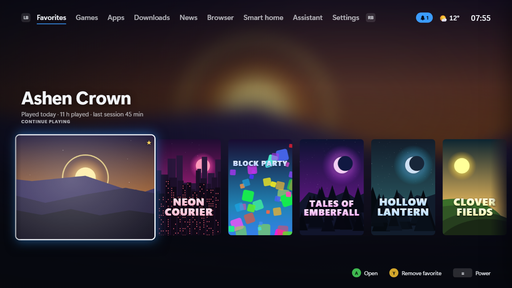

# CouchHUD – Guide

[Deutsch](GUIDE.md) | **English**

The complete guide: every feature, setting, control, the configuration and the architecture. Short overview and screenshots: [README](../README.md#english).

A controller-first full-screen interface for the living-room PC on your TV. If you want, it replaces the whole Windows shell (`explorer.exe`): after sign-in you land directly in CouchHUD, control everything with the controller, and only leave it when you deliberately switch to **PC mode**.

Independent of Steam Big Picture, Playnite and the like, but Steam, Epic, GOG, Ubisoft and Xbox games are found automatically.



## Features

**Interface**
- **English and German**: by default the language follows the Windows display language (German for `de-*`, English for everything else) and can be switched at once under *Settings › Info › Language* (interface, messages, tray menu and setup). Steam store descriptions are loaded in the interface language. Texts and terms: [i18n.md](i18n.md); `scripts/i18n-check.mjs` (part of `scripts/check.sh`) makes sure both languages have the same keys.
- **Console UI** with the tabs Home, Games, Apps, News, Assistant and Settings. Plugins can bring tabs of their own (Smart home with the Home Assistant plugin, say); the Assistant shows up once an AI provider is set up. Scales from 1080p to 4K.
- **Home shelf** with clear logos, large hero artwork and background trailers: when the focus rests on a game for a moment, its Steam trailer starts muted in the background (can be switched off).
- **Colors from the artwork**: the background glows in the color of the focused cover.
- **Depth and motion**: parallax, a slight tilt with a light reflex on the focused tile, a boot screen, page transitions and a transition when a game starts ("Starting game …" with artwork). *Settings › Look › Reduce animations* takes out the depth effect, the tilt and the light reflex.
- **Skins**: the CouchHUD skin ships with the app; Deep Sea, Greenlight, Neon City, Nova, Stardust and more come from the catalog (*Settings › Plugins & skins*), with live preview. If you used one of the former built-in skins, CouchHUD installs it from the catalog on the first start after the update. Your own skins are possible (see [Skins](#skins)).
- **HDR mode** (Off, Automatic, On): artwork and trailers at full HDR brightness, wide-gamut colors per skin (real neon in Neon City), a light reflex over the focused tile, a boot flash. "On" switches Windows HDR on while CouchHUD runs.
- **UI sounds per skin** (synthesized live; your own skins can bring their own sound files) and optional subtle **background music** per skin, each with its own volume control. Everything goes quiet as soon as a game or another full-screen app is in front.
- Controller vibration (can be switched off).
- **Screensaver** against OLED burn-in: artwork slideshow, moving clock, dimming or black, plus pixel shift and, if you like, turning the TV off. Controller input also counts as activity for Windows.

**Library**
- Steam (all library folders), Epic, GOG (with and without Galaxy), Ubisoft Connect and Xbox/Game Pass are found automatically, plus your own entries. EA app and Battle.net are started as game clients, but their games only show up through watched game folders or your own entries.
- **Watch game folders**: everything in, say, `D:\Games` lands in the library automatically, including games installed later. A search finds typical game folders on all drives.
- **Adding**: the last tile of the Games and Apps pages is **+ Add** (also in the filter menu, X). On the Apps page CouchHUD first offers the **list of installed programs** like the Start menu, Store apps such as Claude included (LB/RB jump letter by letter, X searches; "Other …" at the end picks a file). Entries already in the library are marked. Store apps are started by Windows itself (`shell:AppsFolder`); since no program folder is known, CouchHUD does not show them as "running". Adding needs the code while the couch is locked.
- **Startup parameters and working folder** (Expert mode, your own entries with an exe only): in the entry's edit dialog. The parameters go to the program one by one, without a shell; the working folder has to exist. The assistant and MCP cannot change them (only when creating an entry with `add_entry`, which asks on the TV). Example "Claude Code": program `C:\Users\<name>\.local\bin\claude.exe`, parameter `--continue`, working folder `D:\couchhud` (or `wt.exe` with `-d D:\couchhud claude --continue` for Windows Terminal). Terminals, shells and interpreters (`claude`, `python`, `node`, `bash` …) are never games, only apps; on a locked couch they need the code.
- **Batch file as start target** (`.bat`/`.cmd`, expert mode): runs without a visible console window. So the script should not ask for anything: when it waits for input with `pause`, `set /p` or `choice` and for about 15 s nothing runs under it (no game, no `timeout`), CouchHUD ends exactly that cmd.exe (after 30 s at the earliest, earlier once the game has ended) and says so in a notice; also when CouchHUD quits. A game the script starts in the foreground keeps it alive, and so do waiting loops with `timeout` or `tasklist`. `timeout /t 5` works.
- **Scan a folder**: CouchHUD suggests the right exe files and ignores installers, crash reporters and redistributables. You can rename entries, hide them, or file them as a game or an app.
- **Search, sort, filter** (X in Games and Apps): with the on-screen keyboard or your phone, by name, recently used, play time or store, favorites only.
- **Artwork** from SteamGridDB (cover, hero, clear logo; with your own key) and from the Steam store, for non-Steam games too. Local sources come first (Steam's `librarycache`, the Epic Launcher's catalog cache, package logos of Xbox games, the Ubisoft cache, icons of the program files), only then the Steam CDN and SteamGridDB; if nothing is found, CouchHUD draws a banner itself. **Every image is downloaded only once and then kept in the local artwork cache** (`%LOCALAPPDATA%\CouchHud\artwork`, about 750 MB at most, images of current entries are kept). The interface never loads artwork from the internet itself. In Expert mode you can switch online artwork off and clear the cache.
- **Change artwork**: on the details page, "Change artwork" shows all matches from SteamGridDB (with a key) and the Steam CDN for cover, banner and logo. Pick with the controller, A applies, "Automatic" resets, "Own image" takes a file from the PC. The choice is per entry and survives every scan.
- **Collections**: your own lists such as "Couch co-op" or "Kids". Y on a tile in Games and Apps opens the menu with "Collections …" (the details page has the action "Collections"; Y stays favorite there). X in Games and Apps shows a collection as a filter and manages it (create, rename, delete, name via the on-screen keyboard). "Pin to Home" puts a tile into the row on Home.
- **Details page** per game: description, screenshots, developer, genres (from the Steam store, in the interface language), play time, last played, install location, size, uninstall.
- **Running game and play time**: CouchHUD recognizes the running game (Steam app ID or processes in the install folder) and counts play time per game.
- **Back up saves**: save locations, size and last change from the community database [Ludusavi manifest](https://github.com/mtkennerly/ludusavi-manifest) (PCGamingWiki, matched by Steam ID or name). On the details page *Save games* › *Back up now* (a ZIP with the date under `%APPDATA%\CouchHud\Backups\<game>`; folder and number of backups in the settings) and *Restore* (the current state is backed up automatically first). Before uninstalling, a backup is offered. Backups with errors are marked as incomplete and never deleted automatically, safety backups made before a restore rotate separately (last 3), and if writing back fails, the old state is put back automatically. While the game runs (even if it was started outside CouchHUD), both are blocked. Registry saves are shown but not backed up yet. The database (~18 MB) is downloaded from GitHub at most once a week.
- **Automatic backup after playing**: when a game ends (also one started outside CouchHUD), CouchHUD backs up the known save folders after 20 seconds in the background with low priority (*Settings › Library › Back up saves after playing*, on by default). Unchanged saves are not backed up again; it speaks up only on errors or reached limits. Expert mode sets the limits: automatic backups per game (3, apart from your own), size per game (1 GB) and space for all backups (10 GB); bigger folders are skipped, and the limit per game holds for backups by hand too. In the list of backups they show as "automatic, after playing". OneDrive folders are backed up normally; when files are held online only, the automatic backup waits until they are local again so nothing is downloaded (a quiet hint at most once a day). A backup by hand makes no new version when the files are exactly those of the last backup by hand and says "unchanged", before uninstalling too (the matching backup is already there). Restore and delete need an unlocked couch, with parental controls the parent code, and so do the backup settings; the current state is backed up before a restore. The backup folder may not lie in the save places (Saved Games, Documents\My Games, AppData\LocalLow, Steam). If you moved your profile or `C:\Users` to another drive with a junction, CouchHUD refuses the default folder; then pick a folder on the real path in expert mode.
- **Continue playing**: Home starts with the games you played last (up to 6, the running game first, the first card big), each with "last played", total play time and the last session. Locked games show up as in the library. No progress (achievements): there is no reliable local source for it.

**Controls**
- **Guide button like on a console**: the Guide button is read globally via XInput and also works while a game runs. A tap in a game brings CouchHUD to the front; the running game is the first tile on Home and keeps running. *Settings › Controller › Pause game while CouchHUD is in front* (expert mode, off) freezes it instead (*Freezing the game*). **Anti-cheat warning:** a frozen game can look like tampering to an anti-cheat system and get the account banned. So CouchHUD freezes no game with a detected anti-cheat (Easy Anti-Cheat, BattlEye, Vanguard, nProtect GameGuard, XIGNCODE, PunkBuster, Ricochet, mhyprot, ACE, EQU8, FACEIT and similar), detected by files and folders in the game's install folder and by its running processes, without the network. When that cannot be checked (folder missing, a link, too large, unreadable), CouchHUD does not freeze either. Once per game session a message says why. An anti-cheat CouchHUD does not know is not detected: better not freeze online games. Holding it always brings you back from a game or PC mode. What a tap does is set under *Settings › Controller › Guide button in game* (*Open CouchHUD*, *Open Game Bar*, *Hold Guide only*). Two controller slots that mirror each other (virtual pads from Steam Input or DS4Windows) count only once.
- **PlayStation controllers** (DualShock 4, DualSense, DualSense Edge) directly over USB or Bluetooth, without Steam or DS4Windows: Cross = A, Circle = B, Square = X, Triangle = Y, Options = Start, Create/Share and a touchpad click = View, PS = Guide (also in a game, PS + Triangle for the screenshot). CouchHUD only reads the pad (shared, games and Steam still see it), writes nothing to it (no rumble, no light bar) and does not evaluate the gyro or the touchpad. Over USB the pad always reports its battery, over Bluetooth only in its full mode (for example after Steam or a game switched it). When Steam Input or DS4Windows mirror the pad as an Xbox pad, every press counts once. Pads from other makers with a PlayStation licence keep working through Steam Input or DS4Windows; when DS4Windows hides the original (exclusive mode, HidHide), CouchHUD only sees the Xbox pad.
- **Button symbols like on the controller**: hint bars, menus, dialogs and the code entry show the symbols of the controller used last (✕ ○ □ △, L1/R1, OPTIONS, PS or A B X Y, LB/RB, ≡, Guide; other pads count as Xbox). The phone and the keyboard do not change them. To fix them: *Settings › Controller › Button symbols* (expert mode: *Automatic*, *Xbox*, *PlayStation*), for example when DS4Windows hides the pad.
- **Guide menu**: back to the game, quit game (force it if it hangs), volume, app volume, audio output, CPU/GPU/RAM load, weather, battery levels (controllers in four steps, Bluetooth devices in percent, laptop), notifications, Bluetooth, captures, running programs, plugin actions, sleep timer, power.
- **Browser** for the TV: websites with the controller, the stick as mouse pointer, large zoom, bookmarks, address via the on-screen keyboard or your phone. Its own profile without access to CouchHUD. The browser is part of the CouchHUD window (not a window of its own) with a slim bar on top: back, forward, reload, address (tap it for the on-screen keyboard), zoom, start page, close. The bar hides after a few seconds and the View button brings it back; B goes back in the history and closes at the start, LB/RB zoom, Guide leads to CouchHUD, videos play full screen. **Every link in CouchHUD opens here** (news, plugins, website entries), never in the Windows default browser; the couch lock rules apply (locked, CouchHUD asks for the code), and only http and https open. After closing you are back where you came from (e.g. in the article). **Exception, streaming with copy protection:** Netflix, Disney+, Prime Video and the like do not play in the built-in browser (WebView2 ships without Widevine); those website entries have "Open in Edge (for streaming with copy protection)" in the entry's edit menu, preset for known services. Only these use the setting "Open Edge full screen". Known limit: Google blocks sign-ins in embedded browsers.
- **On-screen keyboard** (QWERTZ) and **file browser** for the controller.
- **Mouse**: when the mouse moves, a large comic mouse appears as the pointer (with a wagging tail) and disappears again after a short while. The controller focus stays in charge. For logins and dialogs the controller itself can act as a mouse.
- **Phone as keyboard and remote**: scan the QR code on the TV, then type, dictate or paste on your phone and control with its D-pad and buttons. The connection in your Wi-Fi is not encrypted, so the phone never types into password and key fields: CouchHUD's own on-screen keyboard refuses it for secret fields, and before every keystroke into another window (a launcher login) CouchHUD checks the field with Windows (password field, or a field name such as "Password", "PIN", "Key") and refuses. Such input belongs on the TV. To be honest: Windows cannot look into every field. Where the field stays unknown and the window belongs to a launcher or browser (Steam, Epic, Chrome, Edge, also CouchHUD's own browser), the phone does not type at all and asks for the input on the TV; for games and other programs that give no answer, typing stays allowed. The check happens right before typing, only one check at a time, and only if the same window is still in front. The connection only accepts devices from your own network (private and link-local addresses, never from the internet; addresses from 100.64.0.0/10, i.e. Tailscale and other CGNAT networks, are deliberately refused); paired phones expire after 180 days without use and can be unpaired one by one. The firewall rule only covers the port in use and the local subnet, and disappears when the phone connection and MCP in the network are both off.
- **Notifications** like on PlayStation: cards at the top right, a list in the Guide menu. If you like, also WhatsApp, Discord and others from Windows.

**System**
- **Two modes**: *App* (default, the beginner mode) is a normal full-screen app, with a hidden taskbar if you like; Steam & co. stay as usual and CouchHUD does not step in with clients (no starting, no closing, no moving windows away, no Steam settings). *Shell* unlocks shell replacement, couch lock, auto sign-in, services and taking over startup programs; Steam & co. start with it, run quietly in the background and are closed on quit. Going back to app mode undoes these changes. *Settings › HUD › Mode › Set up shell mode* does all of it in one guided run (see [Settings](#settings)). *What CouchHUD changes in Windows* (transparency) lists every change with its location, admin need (🛡), state and way back.
- **Runs without administrator rights.** What needs admin (lock policies, pausing gaming services, auto sign-in, Windows Update, firewall, updates) is done by the Windows service **CouchHud.Service** from a fixed list of commands, with no UAC prompt day to day. CouchHud.exe never starts itself with administrator rights. What a parent or an administrator must approve, CouchHUD asks for with the parent code or, as the fallback, Windows' User Account Control (see [CouchHUD service, codes and grants](#couchhud-service-codes-and-grants)).
- **Standard account for kids**: CouchHUD needs no administrator token day to day. The service only ever works for the account that calls it, so a normal standard account can set the lock policies without an administrator dialog appearing; they can only be released with an approval (code or Windows sign-in) or as an administrator. If children use the controller, it is best to set CouchHUD up for such a standard account (details and limits under *Runs without administrator rights* and *Couch and PC mode profiles*).
- **Shell replacement** per user (`HKCU\...\Winlogon\Shell`). As the shell, CouchHUD runs **without Windows Explorer**; the desktop (Explorer) only comes in PC mode or after emergency mode. CouchHUD starts the startup programs itself (Run keys and the Startup folder; disabled entries stay off).
- **PC mode**: starts the normal desktop. To get back, hold the Guide button, use the tray icon or restart CouchHUD.
- **CouchHUD stays in front** (shell mode only, can be switched off): the foreground guard minimizes windows of game clients (Steam including Big Picture, Epic, EA, Ubisoft, GOG, Battle.net, Xbox app, Playnite) and of known update pop-ups that push in front of CouchHUD, and the Windows Game Bar hands over the Guide button. Steam holds back too: it does not start in Big Picture mode, the Guide button does not bring Steam to the front, no Big Picture overlay for the controller and no pop-up when a controller connects (Steam's own settings, nothing on your account; the Steam overlay and Steam's Guide shortcuts in games stay). Steam writes its files itself, so CouchHUD only changes them while Steam is not running: if it runs, CouchHUD ends it cleanly only to apply them and only at a quiet moment (no game, no Steam window in front, no download, no sign-in), writes the values and starts it again quietly; otherwise it waits. Putting things back never restarts Steam; it happens as soon as Steam is not running. Exceptions: a game is running, controller-as-mouse (e.g. a login in a client), the browser, PC mode and everything CouchHUD started itself. In PC mode, in app mode and on quit everything is as before (for Steam only what still comes from CouchHUD: if Steam or you changed something in the meantime, it stays).
- **Game clients in the background** (shell mode only; in app mode CouchHUD does not step in): Steam, Epic, GOG Galaxy, Ubisoft Connect, EA app and Battle.net each have a mode (*Settings › Game clients*): *Standby* (default: starts quietly with couch mode so updates and downloads run right away), *On demand* (starts with the first game or action that needs it) or *Off*. When CouchHUD quits and when it switches to PC mode, it closes the Steam it started itself (with `-shutdown`, never by force); a Steam that was already running or that you (re)started yourself is left alone. If Steam is downloading or a game runs, it stays open (with a notice in PC mode). The other clients are left open for now: there is no download detection for them and no proof that closing does not cut anything off. Steam's couch settings are set before CouchHUD starts it and put back after CouchHUD ends it; only a Steam that was running before CouchHUD is restarted briefly for that, at a quiet moment. To sign in, CouchHUD brings the client window to the front, the controller becomes a mouse and the paired phone types into the user name field if Windows reports it as a normal input field (otherwise it asks for the input on the TV); the password goes in through the on-screen keyboard on the TV (Steam also offers the QR login with the Steam app there).
- **Couch and PC mode profiles**: for every startup program, choose whether it starts with CouchHUD or only in PC mode (with a recommendation: gaming tools stay, Office and sync wait). Windows services such as Search or the print spooler pause while you play and come back in PC mode, without a UAC prompt. This is done by the CouchHUD service (CouchHud.Service, LocalSystem, in `C:\Program Files\CouchHud\service`): a fixed list of operations with checked parameters, never "start this program" or "open this path", and always only for the caller's own account. Only services from its own fixed list are paused, and only those it stopped itself are resumed. The service replaces the scheduled tasks of earlier versions; only the reserve task "autologon off" stays for the recovery. If the service is missing, the couch lock stays closed (fail-closed); "Repair service" sets it up again (see [Emergency exit](#emergency-exit)).
- **Audio**: volume, mute, **app volume** (running game first, in the Guide menu), switching the output device (TV, headphones, soundbar). When a headset is plugged in, the output switches automatically.
- **Display**: resolution, refresh rate and HDR, with a "Keep this setting?" countdown as on consoles. Plus a **night mode** (warmer picture, in games too, automatically in the evening if you like).
- **Game profiles** as on the Steam Deck: per game resolution/Hz, HDR, audio output and night mode. Only applies while the game runs.
- **Downloads** (own tab, also in the Guide menu, with a badge at the top right while something loads): everything that downloads or installs, in one place like on a console. Steam installs and updates with progress, Windows updates, app updates through winget, CouchHUD's own update, plugins and skins from the catalog, and the games you started from *Not installed*. A bar appears only where the source really tells its progress; Epic only stores "running" and "done" in a readable way, so it says "Running in the Epic Games client" without a percentage. GOG, EA app, Ubisoft Connect, Battle.net and the Microsoft Store don't store their progress readably and so don't show up (instead of guessed numbers). When a game has finished installing or updating, a notification comes and it is in the library. Finished entries stay for a day (20 at most), X clears them. Pause and cancel games in their client.
- **Games not installed** (tab *Downloads* › *Games not installed*, or X in the Games tab): Steam and Epic games you own that aren't installed here, as a paged cover grid (56 per page, just move past the edge), store filter and search on X. A asks and opens the client's install dialog through its own link (`steam://install/<AppID>`, for Epic `com.epicgames.launcher://apps/…?action=install`); choose folder and space there. Only local files of the clients are read, no account and no internet: for Steam the games that were played on this PC before (`localconfig.vdf`), with names from Steam's app cache; games that never ran here are not reliably known to Steam locally, so CouchHUD doesn't show them. For Epic it is the launcher's catalog cache. A locked couch has to be unlocked first; with parental controls every install then needs the parent code for exactly that game. On a locked couch the unlock lasts two minutes; after that CouchHUD takes the foreground back and also minimizes the client's install dialog. So finish the dialog within that time or unlock again. The list is read again at most every 30 seconds, and not at all while the couch is locked.
- **Bluetooth**: pair and remove headphones, controllers and speakers.
- **Battery** at the top, only on laptops and handhelds: percent next to the clock, ⚡ on the charger. When the PC's battery or a controller runs low (15%), "Battery low" shows once; a low controller shows as a small 🎮 at the top. Connected Bluetooth devices show their battery in the Bluetooth list when they report it to Windows.
- **Wi-Fi**: search networks, connect with the password via the on-screen keyboard, disconnect, status with IP (Settings › Network). The search needs Windows location access.
- **VPN** (NordVPN): a plugin from the catalog ("VPN", *Settings › Plugins*), no longer part of CouchHUD. See the state, quick connect, choose a country, disconnect, and an entry in the Guide menu; the plugin drives the installed NordVPN app through its command line and reads the state off the VPN adapter, without credentials and without asking any service on the internet. Signing in only works in the NordVPN app. Reading works on a locked couch, every change needs the unlock, with parental controls the parent code. If you had set the VPN up in 0.5, the plugin is suggested; *VPN in the Guide menu* and the country chosen last carry over once.
- **Power**: sleep, restart, restart straight into PC mode (once), shut down, sleep timer (sends the PC to sleep after a while).
- **Task Manager** for the TV: running programs with memory use, end the ones that hang.
- **Updates**: Windows Update (search, and install with one confirmation) and app updates via winget, one by one or all at once. The search runs automatically in the background, never during a game.
- **CouchHUD updates itself**: every 12 hours (and on "Check for updates") it asks GitHub for a new version, reports it in the notifications and shows the version and changes in the *CouchHUD* section of the Updates page. "Install" downloads the setup (only from github.com over https), checks the **signature of the checksum file** (ECDSA, the same key as for the catalog) and the SHA-256 of the setup, and hands it to the CouchHUD service. The service checks signature, checksum and version (only newer, no downgrade) once more by itself and installs it silently, without a UAC prompt; then CouchHUD restarts by itself, also as the shell. Without a valid signature nothing is installed, and nothing during a game either. To switch the search off: Settings › Updates › *Automatically check for CouchHUD updates* (`"selfUpdateCheck": false`).

**Protection and emergency exit**
- **Couch lock**: leaving CouchHUD (PC mode, quit, client windows) takes a controller code (six to eight buttons) or the Windows sign-in (Windows Hello, PIN, password). After five wrong tries the wait grows (30 s, 60 s, 120 s … up to 15 minutes, also across a restart). A guard process locks Windows if CouchHUD is closed or crashes, and Task Manager is blocked in couch mode. Ideal together with the automatic Windows sign-in that CouchHUD sets up (the password is entered once, checked and stored encrypted by Windows; CouchHUD never stores it). While the lock is closed, CouchHUD only launches games (apps and websites need the unlock; an app started that way stays *allowed until you return to the HUD*, and CouchHUD shows that), keeps game clients down after their start-up phase (even if CouchHUD started them itself), minimizes clearly recognized non-games (Settings, Explorer, consoles, browsers outside the game), closes file and print dialogs and sets reversible Windows policies (no Control Panel, no Run box, no command prompt, accessibility shortcuts off; cmd, PowerShell, regedit, mmc and wt cannot be started through the Windows shell while locked). The unlock is short and **now also ends with every game start and every return to the HUD, no longer only with parental controls**; in the browser it is extended while in use, and the browser closes as soon as the couch is locked again. The Windows sign-in as the lock requires an account with a password. The controller code also works without a password, CouchHUD then warns clearly; automatic sign-in is left out without a password (Windows signs in anyway then). **To be honest: the lock is only as strong as the account's Windows password** (see the [Disclaimer](DISCLAIMER.en.md)). It keeps children and guests at the controller out, not tech-savvy people with a keyboard, boot media or a removed drive. **Device encryption or BitLocker is recommended** (the one-button setup points this out but does not switch it on).
- **Parental controls** (*Settings › Parental controls*): play time rules for children at the controller.
  - *Parent code*: this is the couch lock's code or the Windows sign-in. **Parental controls are only available on an account with a password**, even with a controller code (otherwise you could simply get past them at the lock screen and in the recovery). The code always counts only for a single action **on one entry**, with its own prompt: it does not open the couch lock, and every change (a setting, extending, releasing a blocked game, changing the code or the lock, moving a game/app to the other category, adding a game or a game folder) asks again. The parent code and the couch code count wrong tries separately. With the Windows sign-in, CouchHUD shows the pending action after the unlock and waits for A; the request lasts three minutes and only for a lock that CouchHUD triggered itself.
  - *Rules*: daily limit (Mon–Fri and weekend separately), play time windows (also across midnight, e.g. 10 pm to 1 am), per-game limit, age limit (by the age rating from the Steam store: USK 6/12/16/18, PEGI 3/7/12/16/18 or ESRB E/E10+/T/M; games without an age rating then only start with the parent code, can be switched off), single games or apps only with the parent code, and "Apps count too".
  - *Counting*: what counts is the running time of the games CouchHUD sees running, including those started without CouchHUD or already running at start-up (library entries with a Steam ID or program folder), not while paused. Entries of the same game share limit and block. Entries without a recognizable process (websites, Store apps without a folder) cannot be measured and therefore only start with the parent code (except apps when "Apps count too" is off). While a game runs, no second one starts, and game clients such as Steam stay minimized (their file dialogs would be a way out of the couch).
  - *Age ratings*: which system counts follows the Windows region automatically (Germany USK, USA and Canada ESRB, the rest of Europe PEGI, else the strictest rating of all systems). In expert mode it can be fixed under *Parental controls › Age ratings by*; with parental controls on that needs the parent code and an unlocked couch. Switching moves every age limit to the nearest step of the new system below it, never looser (e.g. ESRB T → USK 12, USK 18 → ESRB M). When the Windows region is switched to a country with another system under "Automatic", every game gets the stricter rating of the old and the new system until the age limit is saved again; a hint in parental controls shows this. Existing installs with an age limit stay on the USK. When a game has no rating in the chosen system, the strictest of the others counts (ClassInd and CERO too), then Steam's own required age, else it counts as without an age rating. A rating that cannot be read never counts as mild but as unknown. The game page shows the rating in the active system (e.g. "PEGI 16").
  - *When time runs out*: 15 and 5 minutes before, an overlay appears over the game with the real time left (with exclusive full screen it may be missing; the notification in CouchHUD stays). When time is up, the game is paused (not one with a detected anti-cheat, see *Freezing the game* below; then CouchHUD only stays in front of it, the reminder and the close after the grace time stay the same) and CouchHUD comes to the front with *Play time is up*: *Save and quit game* or *Extend with parent code* (+15/+30/+60 minutes; applies to the daily limit, the window and the game; for a window across midnight, extra time before midnight only extends that window, not the next day's limit). Without a decision, CouchHUD closes the game after 60 seconds (close the window, end it after 2 minutes). If the parents extend while the game is already being closed, the closing stops. If it cannot be ended (elevated process), CouchHUD locks Windows (only as long as the time is really up) and keeps asking. Outside the window or after the daily limit, nothing starts, with a notice. The time left is shown in the header and in the Guide menu.
  - *Tamper protection*: the time per day is kept in `playtime.json` (saved every 30 seconds, with an HMAC against editing; a changed or deleted file makes the day count as used up until the parents reset the counter). Counting follows the uptime clock and the time zone saved when parental controls were switched on, not the system clock: changing the clock or time zone gives no extra play time, not even across a restart. If the system clock runs ahead, that is only accepted after confirmation by the HTTPS date of www.microsoft.com or with the parent code, also at start-up (offline it stays at the last saved day). Unlock, parental approval and the wait after wrong tries follow the uptime clock as well. `playtime.json` is written through and replaced with a backup copy.
  - *Requirements and limits*: they only work as the shell with the couch lock on; otherwise (app mode, lock off) there are only notices, and in PC mode they rest. The protection is against children at the controller, not against tech-savvy people: anyone with file access to the user folder can change the settings, and games without a recognizable program folder (URL start only) are not counted but need the parent code. If a game runs that was not started through CouchHUD (Steam, launcher), CouchHUD checks it afterwards against the block list, age limit and time, and treats a violation like time running out. Processes that a game (or its launcher) starts count too.
- **Emergency mode (emergency brake)**: hold Ctrl + Shift or LB + RB + View for about 1.5 seconds during start-up (or three unclean exits in a row within a few hours). This works in two steps, because anyone at the controller could trigger it: first CouchHUD only locks Windows and waits. **Only after the Windows sign-in with the account's password** does it remove the shell entry and the auto sign-in (if CouchHUD set it up), and the normal desktop comes. Choosing "Restart" at the lock screen instead leads back into the couch. Without a couch lock the first step is skipped. If Windows cannot be locked for the first step, even after several tries, CouchHUD changes nothing, counts the unclean exits again (the next start tries once more), shows a message and starts the couch as usual behind its lock: a child at the controller must not reach the desktop without the password. If an auto sign-in remains (set up with netplwiz, say) and CouchHUD is not the shell, a Run entry of the account locks Windows right after an **automatic** sign-in (recognized by the session being signed in within a few seconds); a manual sign-in is not locked again. The entry follows every change of shell, auto sign-in and couch lock, and goes away on uninstall.
- **Robust**: if the UI crashes, it is rebuilt. If CouchHUD does not start at all, it brings back the desktop. Logs are in `%LOCALAPPDATA%\CouchHud\logs`.

**Extras**
- **Weather** in the header (Open-Meteo, no account), with a forecast in the Guide menu.
- **Captures**: a screenshot with **hold Guide + Y**, also in a game, or *Screenshot* in the Guide menu (the menu closes, a running game comes back to the front first). CouchHUD captures the screen the game or CouchHUD is on and saves a PNG to *Pictures › CouchHUD › Screenshots* (`%USERPROFILE%\Pictures\CouchHUD\Screenshots\<game>_<time>.png`, on purpose not a Pictures folder moved into OneDrive); a small message with a preview confirms it. Screenshots stay on the PC: the phone remote, MCP, plugins and the assistant cannot reach them, and the phone cannot take one either. No screenshot while a code (couch, parents', profile code), the pairing code or QR code for the phone, or a secret field of the on-screen keyboard is shown; at most one per second. Allowed under parental controls and on a locked couch. To switch it off: *Settings › Controller › Screenshot with Guide + Y* (expert mode). Notes: the game sees the Y press too; with the combination on, a tap on Guide acts on release instead of at once; when the Game Bar or Steam owns the Guide button, their overlay may end up in the picture. Saving a clip and recording still go through the Game Bar. A gallery for screenshots and clips from CouchHUD, the Game Bar, Steam and NVIDIA.
- **News**: an RSS/Atom reader with large type for the TV. WinFuture and Caschys Blog are preconfigured; add more feeds in the settings.
- **Home Assistant** (smart home): a plugin from the catalog ("Home Assistant", *Settings › Plugins*), no longer part of CouchHUD. Scenes, lights, switches, media players and sensors as live cards in a tab of their own, signing in through Home Assistant's web page in the built-in browser or with a long-lived token, choosing the devices and pinning them to the Guide menu; the plugin also brings tools of its own for the assistant. If you had set up Home Assistant in 0.5, the plugin is suggested; the address, the choice, the pinned devices and the sign-in or token carry over (the token encrypted again for the plugin, never in plain text).
- **CaseHUD**: control the LCDs in your fans and pumps from the couch. [CaseHUD](https://github.com/kewe87/CaseHUD) is a separate program; the integration is a plugin from the catalog ("CaseHUD", *Settings › Plugins*) and no longer part of CouchHUD. More: [CASEHUD.md](CASEHUD.md) (German)
- **TV** (Settings › TV): control LG TVs with webOS. *Find TV* searches the home network (expert mode also takes an IP address); the TV asks once whether to allow CouchHUD (choose "Accept" with the TV remote). Then: on and off, volume (◀▶), mute, choose input; the same three rows are in the Guide menu (switch off with *TV in the Guide menu*). Switching on over the network (Wake-on-LAN) needs "Turn on via Wi-Fi" or "Mobile TV On" in the TV's settings and its MAC address (read while pairing, otherwise enter it in expert mode). Expert mode: *Turn on the TV with CouchHUD* (start and PC wake-up) and *Turn off the TV with the PC* (sleep or shutdown from CouchHUD, only while the TV shows the PC). If the TV shows a different certificate (e.g. after a reset), the page says *Pair TV again*; before pairing again CouchHUD says that it is a different certificate than before. Older TVs without encryption (port 3000) can only be paired in expert mode after a question. While the couch is locked, on/off and volume work; switching inputs and pairing need the unlock (with parental controls the input also needs the parent code, after you chose it). Everything stays in the home network, no cloud.
- **AI assistant** with your own API key (Anthropic or OpenAI): "What should I play today?", "Start the game I played last", "Turn off the light", "Switch to the Neon City skin". You have to confirm every change on the TV with A.
- **MCP server** (optional, off by default): other AI programs, e.g. on a laptop, control CouchHUD through the Model Context Protocol, with the same tools as the assistant.
- **Plugins and skins** from the community, installable directly as a `.zip` or from the **catalog**, with update hints. Included: **Wand** (formerly WeMod) for cheats and mods. The default catalog [`kewe87/CouchHUD-Catalog`](https://github.com/kewe87/CouchHUD-Catalog) contains real entries (Wand, Synthwave) with a signed index and checksums.

## Settings

Everything can be configured in **Settings** with the controller. You don't have to touch `config.json`. The settings have two levels:

- **Simple** (default): only the everyday things (Library, Look, Display, Sound, Controller, Phone, News, Weather, Notifications, Updates, Power, Parental controls, Info) and, at the very top, the **HUD** category with the setup assistant, mode, couch lock, code and the way to parental controls. *Mode › Set up shell mode* turns the PC into a console in one run (Windows shell, startup profiles, paused services, Guide button for CouchHUD, couch lock with a controller code, automatic sign-in, shell). Before, an overview shows what will happen; afterwards it lists what worked and what was skipped (with the reason). Running it again repairs. *Mode › Back to normal Windows* undoes everything. At the end CouchHUD offers a restart to try it out.
- **Expert mode** (*Settings › Expert mode*): also shows all the fine adjustments, inside the categories as a separate "Expert" section (e.g. refresh rate, HDR effects, sound set, hold time of the Guide button) and as categories of their own below the divider (Windows integration, Startup & services, Network with the firewall rule, AI & MCP, Plugins & skins). Every setting exists in only one place. Actions such as Bluetooth devices, viewing notifications, captures, running programs and quick power actions are in the Guide menu.

### Areas

CouchHUD does not have to be a game console: under *Settings › HUD › Areas* (and in the setup assistant) you switch whole areas on or off, for example for a plain app and browser launcher without games. Everything is on by default. One of games, apps and browser always stays on.

| Area | What disappears or stops with it |
|---|---|
| **Games** | The Games tab, games on Home and Continue playing, scanning Steam, Epic, GOG, Ubisoft, Xbox and game folders, store match, SteamGridDB and store art for games, save backups (automatic and manual, with their settings and notifications), game downloads and games not installed, the game clients in the background (when switching off, CouchHUD closes only those it started itself, and Steam not during a download or a game; what ran before or what you started yourself keeps running) and CouchHUD's Steam settings, game profiles, the game rows in Settings (game folders, game clients, scan a folder, SteamGridDB, trailers, pause the game) and the game clients step of the assistant |
| **Apps** | The Apps tab, your programs and web apps on Home, the list of installed programs |
| **Browser** | The Browser tab, the browser tile and its Guide-menu row, bookmarks, web pages as tiles and entries that start a browser (Chrome, Edge, Firefox …), "Maximize browser" |
| **News** | The News tab, the feeds and the News category in Settings, `get_news` for the assistant and MCP |

Always there: Home, Downloads (Windows and CouchHUD updates), Settings, profiles, parental controls, couch lock, power, TV, back to the running game and quitting it.

- **Really gone, not only hidden:** CouchHUD refuses every call of an area that is off (also from the assistant, MCP and the remote) and its background work does not run. The data (favorites, play time, backups, bookmarks, feeds) is kept and back when you switch the area on again.
- **Marked as an app stays:** if you set a store entry to app in its details (say Wallpaper Engine from Steam), CouchHUD keeps reading that store with games off and shows exactly those entries in the Apps tab; the games next to them stay gone.
- **Parental controls stay strict:** with parental controls on, CouchHUD keeps reading the game stores even with games off (without art), so games started outside are recognised and play time and limits still count. Apps count as before only with "Count apps" on.
- **Changing** the areas is a settings change: only unlocked, with parental controls only with the parents' code, never on a locked couch, never through remote commands, MCP, plugins or the assistant.
- **For developers:** which setting, bridge call, assistant tool and background service belongs to which area is in one place: the table in `src/CouchHud.Core/Config/FeatureAreas.cs` (the page mirrors the settings in `ui/core/areas.js`). New features declare their area there (or "always"); tests fail when a setting key or a bridge call is in none of the lists.

## Controls

| Controller | Keyboard | Action |
|---|---|---|
| D-pad / left stick | Arrow keys | Navigate |
| A | Enter / Space | Open / select |
| B | Esc / Backspace | Back |
| X | X | Context action (e.g. refresh news, check for updates; in Games and Apps: search, sort, filter, collections) |
| Y | F / Y | On Home and the details page: favorite on/off. In Games and Apps: tile menu (favorite, collections …, details). |
| LB / RB | Q / E or Page Up / Page Down | Switch tab |
| Start (≡) | M | Power menu |
| Guide button (the middle button of the pad) | Home | Guide menu. A tap in a game brings CouchHUD to the front (setting). **Holding** it always brings you back from a game or PC mode |
| Hold Guide + Y | – | Screenshot, also in a game (setting) |
| Back + Start | – | Alternative to the Guide button |
| LB + RB + View at start-up, ~1.5 s | Ctrl + Shift at start-up, ~1.5 s | Emergency mode: then the normal desktop instead of CouchHUD |

On-screen keyboard: A types, X deletes, Y space, LB shift, RB symbols, Start (≡) done, B cancel. With a real keyboard you type straight into the field; Enter finishes the input, Esc cancels. When you drive the keyboard with arrow keys (a remote), Enter presses the marked key and **Ctrl + Enter** finishes the input.

### Controller gone?

Battery empty, Bluetooth switched off by accident or the receiver unplugged: CouchHUD always works with **keyboard** and **mouse** (or touch) too, including the couch lock's code prompt and the parent code.

- **Code without a controller:** below the dots of the code prompt are the ten code buttons (A, B, X, Y, LB, RB, ↑ ↓ ← →) to click. On the keyboard: **Enter = A, Esc or Backspace = B, X, Y, Q = LB, E = RB, arrow keys = D-pad**; **M** cancels (in the code prompt Esc is the B button, not "cancel"). It is the same code; the CouchHUD service checks it the same way and counts wrong tries the same way (after 5 wrong ones every further try waits longer). With no controller connected, the code prompt says so and shows where Bluetooth stands.
- **Bluetooth comes back on:** while a Bluetooth controller is paired and no other controller is connected, CouchHUD switches Bluetooth back on at start (so also after a restart of the PC) and whenever it goes off. If keyboard or mouse were just in use, a 10-second countdown comes first with *Switch on now* and *Leave Bluetooth off*; B or a click next to it only hides it. While a code prompt or the time-up page is on screen, the countdown does not cover it (only a hint) and comes afterwards. *Leave Bluetooth off* lasts until Bluetooth is on again or CouchHUD restarts. In **airplane mode** (every radio off) the same applies at start too: with keyboard or mouse the countdown comes first; without any other input, CouchHUD still switches Bluetooth on so nobody is locked out. CouchHUD only switches on the existing Bluetooth: it never pairs new devices and never makes the PC discoverable. If Bluetooth is disabled in Device Manager, by policy or by a hardware switch, or the adapter is missing, that only goes to the log. If switching on fails, CouchHUD retries with growing gaps (30 s up to 15 min) and stops after 6 failures until the next start; at most 3 times in 10 minutes. If something else keeps switching Bluetooth off, CouchHUD stops after two full 10-minute windows until the next start. To turn it off: *Settings › Controller › Switch Bluetooth on automatically for controllers* (Expert mode, needs the code while the couch lock is on).
- **Switching Bluetooth off in CouchHUD:** if your controller is connected over Bluetooth, CouchHUD asks first. If another controller is connected or keyboard or mouse were just in use, Bluetooth then stays off (like *Leave Bluetooth off*); otherwise it comes back by itself after a short while.
- **When nothing works any more:** press `Ctrl + Alt + Del`, then **Sign out** or **Restart** at the bottom right. After the restart CouchHUD switches Bluetooth back on by itself (see above), and the controller reconnects as soon as you switch it on with the Guide button.

## Setup

Requirements: Windows 10/11 (the WebView2 runtime is included from Windows 11), an Xbox or XInput controller, or a DualShock 4 / DualSense (directly, without Steam Input or DS4Windows).

**Setup (recommended):** under [Releases](https://github.com/kewe87/CouchHUD/releases), or for every build under *Actions → build → Artifacts → CouchHud-Setup*, you find `CouchHud-Setup-<version>.exe`. The setup (English and German) installs to `C:\Program Files\CouchHud` (the protected folder the admin features rely on), brings the WebView2 runtime if needed and creates a Start menu entry, optionally a desktop icon and autostart. It changes nothing about the Windows sign-in: CouchHUD starts in *app mode*. Uninstalling resets everything CouchHUD changed in Windows and asks whether the settings should be deleted. The setup is not Authenticode-signed (yet), so SmartScreen warns on first start ("More info › Run anyway"). CouchHUD's own update check is signed independently of that (see self-update).

**First start:** a setup assistant asks a few questions, one per screen: language, confirming the disclaimer and privacy notice, which **areas** you want to use (games, apps, browser, news), *App* or *Shell*, skin with live preview and mouse pointer, sound, and with *Shell* and games on the game clients (*Keep ready* or *On demand*). Choosing *Shell* is only noted: only *Let’s go* on the summary starts the shell mode setup from *Settings › HUD* (with administrator approval, controller code and a restart offer); if it stays incomplete, CouchHUD briefly says so afterwards. During the assistant and the first notice, no notification cards appear, only the bell counts. Y skips any step, ≡ ends the assistant; everything stays changeable in Settings, and the assistant itself sets nothing that is not there. To run it again: *Settings › HUD › Setup assistant*, at the very top (with the couch lock on, only after the code). Older installs are offered it once, never forced into it.

**Without the setup:** unpack the ZIP `CouchHud-win-x64` from the artifacts to `C:\Program Files\CouchHud` and start `CouchHud.exe`. The build brings .NET along (self-contained); it only needs the WebView2 runtime, which is included in Windows 11.

**Creating a release** (for maintainers, details in [CONTRIBUTING.en.md](../CONTRIBUTING.en.md#release)):

1. Set the version in `Directory.Build.props`, push a tag: `git tag v0.4.0 && git push origin v0.4.0`. CI builds the setup with this version and attaches `CouchHud-Setup-0.4.0.exe` and `CouchHud-Setup-0.4.0.exe.sha256` to a GitHub release. A tag build fails if the tag does not match the version in `Directory.Build.props`.
2. Check and sign locally: `.\scripts\sign-release.ps1 -Tag v0.4.0` (PowerShell 7, GitHub CLI `gh` signed in). The script checks the commit, version and hash of the setup and the CI's build attestation, and only then signs the `.sha256` (context `couchhud-release-v1`) with the private key from the user profile; then it uploads `.sha256.sig`.

Only after step 2 do installed CouchHUDs offer the update. The release notes (generated from the pull requests, editable after the tag) appear shortened on the TV.

**Build it yourself** (.NET 10 SDK, for the setup also [Inno Setup 6](https://jrsoftware.org/isinfo.php)):

```powershell
dotnet build CouchHud.slnx
dotnet test CouchHud.slnx
dotnet run --project src/CouchHud.Shell -- --dev   # window mode with DevTools
dotnet publish src/CouchHud.Shell -c Release -r win-x64 --self-contained true -o publish
iscc /DAppVersion=0.4.0 installer\CouchHud.iss    # optional: setup into installer\output
```

For the console experience, then choose "Set up shell mode" under *Settings › HUD › Mode*. At the next start CouchHUD appears instead of the desktop. If you prefer to switch things on one by one, turn on Expert mode and find everything under *Windows integration*.

### Important Windows settings

- **Xbox Game Bar and the Guide button**: by default the Game Bar grabs the Guide button. With "Set up shell mode" (or *Settings › Controller › Guide button in game › Open CouchHUD*) the Game Bar hands the button over while "CouchHUD stays in front" is on (CouchHUD backs up the old value and restores it in PC mode, in app mode and on quit). By hand: under *Settings → Gaming → Xbox Game Bar*, turn off the option "Open Xbox Game Bar using this button on a controller". Back + Start works as an alternative.
- **Auto sign-in**: for a real console feel, via “Set up shell mode” (or in Expert mode under *Windows integration › Set up automatic sign-in*). You enter your Windows password once with the on-screen keyboard on the TV (never through the phone); CouchHUD checks it with Windows and has Windows store it encrypted as an LSA secret (as with Sysinternals Autologon). CouchHUD does not store the password, neither in the configuration nor in the log. Whoever switches the PC on lands in CouchHUD, and the couch lock protects the way out: please set both up together, and protect the drive with BitLocker/device encryption. On uninstall the sign-in is removed again if CouchHUD set it up. `netplwiz` remains an alternative for experts (there the phone does not type along; the password goes in through the on-screen keyboard).

### Emergency exit

If something goes wrong and you only get a black screen:
1. Hold **Ctrl + Shift** (or **LB + RB + View**) for about 1.5 seconds during start-up: Windows locks, and **after you sign in with the Windows password** the normal desktop comes. The owner knows the password (it is the account password, not the couch code). An account without a password only needs one click at the lock screen for this, which is why parental controls require a password.
2. Otherwise: `Ctrl + Alt + Del` → **Task Manager** → *Run new task* → `explorer.exe`
3. Remove the shell entry: `reg delete "HKCU\Software\Microsoft\Windows NT\CurrentVersion\Winlogon" /v Shell /f`

**Repair service**: if the CouchHUD service no longer runs, "Repair service" sets it up again with its fixed, hardened configuration (Windows programs only: `sc.exe`, `icacls.exe`, `reg.exe`). Before you confirm the UAC prompt, open *Show more details*: the program must be `C:\Windows\System32\cmd.exe` with the command line `/d /c ""C:\Program Files\CouchHud\repair-service.cmd""`. If it shows anything else, cancel.

### CouchHUD service, codes and grants

Everything that needs administrator rights is done by the **CouchHUD service** (`CouchHud.Service`, runs as SYSTEM, lives in `C:\Program Files\CouchHud\service`). CouchHUD itself never runs with administrator rights and talks to the service only over a local pipe; before every contact it checks that the pipe really belongs to the service. The service only ever acts for the account that calls it (taken from its Windows sign-in, never from the request), and only from a fixed list of actions.

- **Codes and the lock mode live in the service.** The service checks the couch code and (with parental controls) the parent code itself, with its own count of wrong tries per code: after five wrong codes every further try has to wait, 30 seconds first, then twice as long each time, at most 15 minutes. The count survives restarts of the service and the PC. The service also knows the account's lock mode (off, Windows sign-in, code): switching it on or making it stricter is always possible, weakening or switching it off only with proof of the current mode (code or unlock) or with a parent or an administrator. The first code is free only while no lock is on, and survives a lock being switched on only if it is set in that same step (CouchHUD asks for the code when the code lock is switched on); the code mode without a code stays closed. Switching off also removes the code from the service, and so does switching to the Windows sign-in (there only the unlock counts; CouchHUD says so before the switch). Going back to the code, you set a new code right away and confirm it once with the Windows sign-in (with parental controls, with the parent code), no administrator needed; "parental controls off" removes the parent code. The configuration in the user folder no longer holds a code hash. The service's data (`service\data`) can only be read by SYSTEM and administrators. *Settings › HUD* shows which codes the service holds for this account.
- **Update from 0.4.0 with the couch lock on:** the lock stays on. The first time it is opened after the update, an administrator confirms it once through the Windows prompt (UAC; program `sc.exe`). CouchHUD says first what is confirmed and why: for the code lock "the code just entered", which then is the lock's only code; for the Windows sign-in the "Windows mode". Reason: in 0.4.0 codes were kept in a file any program of the account could change. Every other code the account had, a parent code too, no longer counts afterwards; you set a parent code again in the settings. If the code entered does not match the stored one (or none is stored), CouchHUD first asks whether an administrator should confirm it as the new code; UAC only comes after "Confirm as administrator". If the lock was confirmed with the old 0.4.0 code, CouchHUD reminds you that this code lay readable in the configuration: set a new code in the settings afterwards. Until then neither the code nor the Windows sign-in nor a parent code releases the lock, only an administrator; until then the lock mode can only be changed that way, and single codes not at all. Afterwards the code opens it as usual.
- **Grants.** A correct couch code gives a grant for 2 minutes (the unlock window), bound to the account, the Windows sign-in and the Windows session. It ends earlier when the session is locked, disconnected or signed out, and does not count while the session is locked. With it the service releases the lock policies, opens the firewall rule, or keeps the session during an update. In the "Windows sign-in" lock mode, the unlock of the caller's own session counts instead, as seen by the service itself; never in the code mode, never for an account without a password, and never a mere sign-in.
- **What a parent or an administrator must approve**: the automatic sign-in, changing or removing the parent code, changing or removing the couch code next to a parent code, weakening the lock while there is a parent code, opening a lock that has no code. CouchHUD asks for the **parent code**; the grant then counts only for exactly that action, once, for 30 seconds. If that does not work (no parent code, too many wrong tries), an **administrator** of this PC approves through Windows' **User Account Control (UAC)**: CouchHUD first says what is being approved; then Windows' own UAC prompt on the secure desktop shows the program `sc.exe` (service control) with `control CouchHud <number>`. The administrator's password is typed only into that Windows prompt; CouchHUD never sees it. The grant goes to the account at the couch, not to the administrator, only for the named action, once; the request expires after 60 seconds. When a parent or an administrator sets a single code anew, the other one goes (a planted code does not survive that); with parental controls CouchHUD always sets both.
- **Parent code.** With parental controls, the parent code is the couch code. The service only takes it together with a new code (both in one step) or with the approval of a parent or an administrator; the couch code alone never makes a parent code. So when parental controls are switched on at an unlocked couch, CouchHUD asks for the code right away and saves it as couch and parent code; an administrator approves that once through UAC. When they are switched on at a locked couch, CouchHUD deliberately sets no code (a locked couch takes no new code); then set the code again at the unlocked couch.
- **Takeover on update.** On first contact the service takes over the code hash and the lock mode from the configuration, once per account. **Honest limit:** at that moment the service cannot know whether a program of the user changed the configuration before. It only accepts a hash in CouchHUD's format, never over a code it already knows, and a mode never weaker than the one it already knows; from then on it is the authoritative source. If the service holds codes the settings do not know, the setup assistant points it out.

**Honest limits of the service**
- An administrator's password never passes through CouchHUD: Windows' UAC prompt takes it. **Honest limit:** the prompt shows only `sc.exe control CouchHud <number>`, not the action. Only one request is open per session; a program that already runs as your account could still place its own before CouchHUD does (another action, same account), and an approval binds the action, not its details. So only approve when you just started the action yourself and CouchHUD just announced it. The automatic sign-in password and the code buttons, however, arrive as .NET strings, which cannot be wiped and stay in memory until the garbage collector removes them. None of it is logged.
- The **Windows sign-in** still opens the way when the service is not running (emergency exit above): whoever knows the account's Windows password gets to the desktop. A sign-in gives no grant in the service, though: whatever a crashed run left restricted, the service releases afterwards only with the code, an unlock in Windows mode, or an administrator (UAC).
- A program that already runs as your account can read the controller and take grants from CouchHUD's memory. The service raises the bar against children at the controller and against the UAC boundary, not against malware in your own account.
- The "account without a password" check shows up once per account and service start as a failed sign-in in the security log.
- **"Repair service"** asks for an administrator through UAC and only starts `cmd.exe` with the fixed repair script from the program folder (see above; check the details in the UAC prompt).

## Skins

Switch under *Settings › Look › Skin*, with a live preview while you browse (B cancels). The Couch skin is built in; Deep Sea, Greenlight, Neon City, Nova and more come from the catalog (*Settings › Plugins & skins*).


A skin is a stylesheet plus optional button glyphs and sounds. Your own skins go to `%APPDATA%\CouchHud\skins\<name>\`:

```
skin.json  { "name": "My skin", "description": "…", "glyphs": { "A": "✕", "LB": "L1" } }
skin.css   :root[data-skin="user:<name>"] { --accent: hotpink; --tile-radius: 0; … }
```

The most important variables: `--bg`, `--fg`, `--muted`, `--accent`, `--accent-glow`, `--panel`, `--font`, `--tile-radius`, `--shelf-tile`, `--focus-scale`. For everything else you can override the selectors from `ui/styles.css`; the skins in the catalog show how far that goes. A skin's glyphs are only styling for the matching kind of controller: which symbols appear is decided by the controller (or *Settings › Controller › Button symbols*). PlayStation glyphs as in the example only apply with PlayStation symbols, all others only with Xbox symbols. Full instructions: [SKINS.en.md](SKINS.en.md).

## Configuration

`%APPDATA%\CouchHud\config.json` is created on first start. Everything in it can also be changed in Settings; the file is only the storage. Secrets (API keys, tokens) are stored there encrypted with DPAPI. **If the file is damaged or unreadable**, CouchHUD runs locked (Windows sign-in as the couch lock, parental controls strict: no game starts) and writes nothing to the file until it is usable again. Unreadable (e.g. held by another program): CouchHUD tries again every 15 seconds. Damaged: **the way out is to repair or delete `config.json`** (CouchHUD then starts with defaults; lock and parental controls are off afterwards). Next to it lies a copy `config.json.<time>.bad` (the same content only once, at most five), which is only a copy: better edit or delete the actual `config.json`. The few emergency fields (the "shell removed" notice, returning to the couch) are kept in `config.json.recovery` meanwhile and merged back after the repair. An excerpt:

```json
{
  "killExplorerOnReturn": false,
  "runStartupApps": true,
  "sounds": true,
  "audioMode": "ui",
  "musicVolume": 35,
  "guideTapInGame": true,
  "pauseGameInMenu": false,
  "screensaverMinutes": 5,
  "screensaverStyle": "art",
  "displayOffMinutes": 0,
  "pixelShift": true,
  "reduceMotion": false,
  "language": "auto",
  "integrationMode": "light",
  "closeExplorerInLight": false,
  "browserZoom": 150,
  "couchLock": "off",
  "blockTaskManager": true,
  "returnHoldMs": 1000,
  "skin": "user:nova",
  "steamGridDbApiKey": "",
  "apps": [
    { "name": "YouTube", "type": "app", "url": "https://www.youtube.com/tv" },
    { "name": "Kodi", "type": "app", "path": "C:\\Program Files\\Kodi\\kodi.exe", "image": "C:\\Pictures\\kodi.png" },
    { "name": "Retro emulator", "type": "game", "path": "D:\\RetroArch\\retroarch.exe", "args": ["-f"] }
  ]
}
```

- `killExplorerOnReturn`: end `explorer.exe` when switching back from PC mode (cleaner, but closes open Explorer windows).
- `runStartupApps`: run the startup entries at boot when CouchHUD is the shell.
- `language`: `auto`, `de` or `en`.
- `steamGridDbApiKey`: an optional, free key from [SteamGridDB](https://www.steamgriddb.com/profile/preferences/api) for covers of non-Steam games and apps. Without a key, CouchHUD searches the Steam store by name.
- `image`: cover as a local path or URL (portrait 2:3 for games, 16:9 for apps).

## AI assistant and MCP

Under *Settings › AI & MCP* (Expert mode) you choose the provider (Anthropic or OpenAI), enter your API key (encrypted with Windows DPAPI) and pick the model. Then the **Assistant** tab appears.

The assistant only works through a fixed list of tools: search the library, read details, launch, favorites, edit and add entries, rescan the library, change settings and skin, weather, news, updates, volume, audio output, power; tools of installed plugins (Home Assistant, say) come on top and you confirm them on the TV. It runs no shell commands and does not access files. It never sees API keys and tokens. While the couch lock is closed it is left with looking things up and launching from the library.

**MCP server**: switching it on creates a token. The address and the token are shown in the settings. Example for an MCP client with Streamable HTTP:

```json
{
  "mcpServers": {
    "couchhud": {
      "type": "http",
      "url": "http://192.168.178.42:8765/mcp",
      "headers": { "Authorization": "Bearer <token from the settings>" }
    }
  }
}
```

Without "Reachable from the network" the server only listens on `localhost`. For access from the LAN, the CouchHUD service (with a grant, without a UAC prompt) creates a firewall rule named **"CouchHUD Remote (CouchHUD)"** (allow only, inbound, TCP); it only covers the ports in use (default 8765) and the local subnet. Windows' own rules are not touched; Windows block rules are only reported. The server only accepts requests from your own network (private and link-local addresses). Every change from outside is shown by CouchHUD as a question on the TV (the answer only comes from the TV, never from the phone); plugin tools are always confirmed over MCP, with their arguments. On a locked couch, the assistant and MCP only offer looking things up and launching from the library.

## Plugins and skins

CouchHUD is meant to grow with the community. Both can be installed directly in the interface as a `.zip` (*Settings › Look › Install new skins*, or in Expert mode *Plugins & skins*).

- **Plugins** (C#, SDK v2) add game sources, their own pages, settings, Guide menu entries and tools for the AI assistant, and react to games starting and ending. CouchHUD renders plugin interfaces itself, so they fit every skin and work with the controller. Instructions: [PLUGINS.md](PLUGINS.md) (German)
- **Skins** (CSS) change colors, fonts, shapes and layout. Instructions: [SKINS.en.md](SKINS.en.md)
- Included: **Wand** (formerly WeMod), cheats and mods through the Guide menu, automatically with every game if you like. It is also the example for your own plugins.
- **Catalog**: *Plugins & skins › Catalog* lists plugins and skins from a JSON index on GitHub (default `kewe87/CouchHUD-Catalog`, more sources in `config.json`). The default catalog's index is signed; installing and updating work with A, only over https and with a mandatory checksum (SHA-256); before plugins CouchHUD warns that they run with your rights. In the background (never during a game) CouchHUD checks for updates and reports them in the notifications and on the Updates page. Format and security: [PLUGINS.md](PLUGINS.md#katalog) (German)
- **Approved plugins**: the list of approved plugins (`plugin-trust.json`) is signed with an HMAC (same key as `playtime.json`, bound to the Windows account with DPAPI). It protects against a program or script that merely writes files, not against a program running as the same account (it can read the key too). If the signature does not fit, the plugins show an error, nothing unknown loads and the file is not overwritten; delete it to start over (what lies in the plugin folder then counts as approved at the next start, as on the very first start).

How you can contribute: [CONTRIBUTING.en.md](../CONTRIBUTING.en.md)

## Architecture

```
ui/                        Web UI (vanilla JS/CSS as ES modules, no build pipeline), runs in WebView2
  app.js                   Start-up, tabs, global keys
  core/                    Navigation, state, library, artwork, trailers, weather, i18n
  views/                   Home, grid, details, news, assistant, updates, settings
  components/              Overlay menus, Guide menu, on-screen keyboard, file browser, mouse
  i18n/de, i18n/en         Interface texts (one file per area)
  skins/                   Built-in skins
  bridge.js / mock-api.js  Host bridge (chrome.webview) or mock data for the browser preview
src/CouchHud.Sdk/          Plugin API
src/CouchHud.Core/         Platform-neutral and tested: config, scanners (Steam/Epic/custom),
                           artwork, store info, play time tracking, save games, parental controls,
                           file browser, exe scan, weather, news, winget parser,
                           AI assistant, MCP protocol, catalog and self-update, texts (Localization)
src/CouchHud.Shell/        WPF + WebView2 host
  Hud.cs                   Orchestration: Guide button, PC mode, tray, bridge API
  Input/XInputPoller.cs    XInput incl. Guide (XInputGetStateEx), vibration, battery
  Input/PlayStationHid.cs  DualShock 4 / DualSense over HID, read-only
  Native/                  Win32 and Core Audio (COM)
  Services/                Shell registry, startup, power, launcher, audio, updates, couch lock,
                           foreground guard, parental controls, assistant tools, MCP server (Kestrel)
  UiHost/                  JSON bridge to the UI, local files for artwork/skins
plugins/                   Included plugin (Wand)
installer/                 Inno Setup script
catalog/                   Example of a plugin catalog (index.json + signature)
scripts/                   check.sh, i18n check, preview server, signing and VM scripts
tests/                     xUnit tests for Core
```

Everything with admin rights is done by the Windows service **CouchHud.Service** (`src/CouchHud.Service`, LocalSystem) over a named pipe with a fixed command list; the shell itself never needs admin. Protocol in `src/CouchHud.Service.Contracts`, admin code in `src/CouchHud.Privileged`, client in `src/CouchHud.ServiceClient`.

## UI development without Windows

```bash
node scripts/preview-server.js   # http://localhost:5173, the complete UI with mock data in the browser (?lang=en for English)
```

More on this (screenshots with `ui-shot.mjs`, VM tests) in [CONTRIBUTING.en.md](../CONTRIBUTING.en.md).

## Disclaimer and privacy

CouchHUD is provided without warranty; you use it at your own risk: [Disclaimer](DISCLAIMER.en.md). No telemetry, no account. Which data is stored locally and which services CouchHUD contacts when is described in the [privacy notice](PRIVACY.en.md). You confirm both on first start. In case of doubt, the German versions prevail.

## License

Copyright © 2026 **kewe87**

This program is free software under the **GNU General Public License v3.0**
([LICENSE](../LICENSE)). You may use, change and pass it on, but forks and
derivatives must also stay open under the GPL-3.0 and keep the copyright notice "kewe87".
